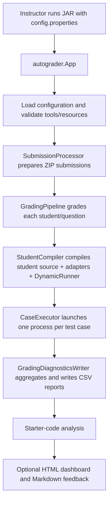

# How This Auto-Grading System Works

This guide traces the program from the instructor's command to the generated reports. It names the files, methods, subprocess arguments, result tokens and test rules that take part in grading. Feature 4 is explained in detail, including what it checks to expose solutions that only memorize the supplied fixed examples.

## System Architecture & Execution Overview

The instructor starts one Java process with the configuration file. The app prepares each submission, then starts separate compiler and test-runner processes for each student's question. It combines the case results into marks and writes reports in a new run directory.



The current assessment has five question parts: `Q1a`, `Q1b`, `Q2a`, `Q2b`, and `Q3`. The run contains 20 fixed instructor cases and 25 dynamic cases (five per question), for **45 cases per submission**. Dynamic checks supplement the fixed cases; they do not add points to the assessment. Each question's configured maximum is split across all of that question's fixed and dynamic cases.

## End-to-End Program Flow

### 1. User command enters `App`

From the repository root, the instructor builds and runs:

```text
mvn clean verify
java -jar target/auto-grading-system-1.0-SNAPSHOT.jar config.properties
```

The JAR manifest starts `autograder.App.main(String[] args)` in `src/main/java/autograder/App.java`. `main` calls `App.run(String[] args)` and exits with a nonzero status if `run` returns an error code.

`App.run` accepts either the single argument `--help` or exactly one configuration path. For a normal run it loads:

- `AppConfig.load(Path)` — assessment, roster, score sheet, archive and workspace settings.
- `ExecutionConfig.load(Path, AppConfig)` — Java/Javac commands, run directory, score report name, deadlines and output-size limit.
- `PlagiarismConfig.load(Path)` — similarity-detector settings.
- `HtmlReportConfig.load(Path)`, `FeedbackConfig.load(Path)` and `BoilerplateConfig.load(Path)` — optional report and starter-analysis settings.

It builds `GradingPipeline`, chooses `NGramPlagiarismDetector` when plagiarism is enabled, and calls `GradingPipeline.validateEnvironment()`. That method checks that configured `java` and `javac` execute and that every question's tester file, fixture and support class exists and is readable. Test-case definitions are also constructed in the pipeline constructor before student processing starts.

### 2. ZIP submissions are matched and prepared

`App.run` constructs `SubmissionProcessor` and calls `SubmissionProcessor.processBatch()` (`src/main/java/autograder/submission/SubmissionProcessor.java`). This method:

1. Loads the configured score sheet through `ScoreSheetRepository.load()` and checks that every row's denominator matches the configured assessment maximum.
2. Calls `findArchives()` to list regular files in the configured submission directory that match `archive.file.regex`; the list is sorted by filename.
3. Creates unique extraction and working-copy directories for this batch.
4. Calls `processArchive(...)` for each ZIP. The processor's collaborators include `SafeZipExtractor`, `IdentityResolver`, `SubmissionValidator` and `WorkingCopyPreparer`. They extract within configured limits, resolve a student from archive/source identity details and roster data, validate the expected question files, and create a grading working copy.
5. Records anomalies and corrections using `AnomalyLog` and `CorrectionLog`, and marks duplicate roster matches for review.

The method returns a `List<SubmissionResult>`. Each item contains the archive path, resolved `StudentIdentity`, preparation `SubmissionStatus`, working-copy root, anomaly details and correction details. `App.printResults` displays the preparation status. `READY` means the archive was prepared for grading; it is not a passing grade. A `REVIEW_REQUIRED` warning does not automatically prevent grading.

### 3. The grading pipeline chooses and weights cases

`GradingPipeline` is in `src/main/java/autograder/grading/GradingPipeline.java`. Its constructor creates:

```text
InstructorTestCaseProvider
DynamicTestCaseProvider
CombinedTestCaseProvider(fixedProvider, dynamicProvider)
```

It calls `CombinedTestCaseProvider.load(AssessmentDefinition)`, stores the returned immutable `List<TestCaseDefinition>`, and uses that same case definition list for each submission. Each definition contains a case ID, question ID, runner class, runner arguments and maximum points.

`GradingPipeline.grade(List<SubmissionResult>)` creates a fresh grading run directory, counts duplicate resolved student IDs, and calls `gradeSubmission(...)` for each submission. A submission with unresolved/duplicate identity or failed preparation receives `NOT_RUN` case results and a withheld-export reason. Otherwise, `gradeSubmission` creates a per-submission workspace and calls `gradeQuestion(...)` for each configured question.

`gradeQuestion(...)` selects cases with `casesFor(questionId)`, calls `StudentCompiler.compile(...)` once for that question, then calls `CaseExecutor.execute(...)` once for every selected case if compilation succeeded. A compile failure is recorded for each case in that question; the pipeline continues with other questions. Infrastructure errors mark affected cases `NOT_RUN` and withhold the submission from score export.

### 4. Compilation and case processes are isolated by question and case

`StudentCompiler.compile(QuestionDefinition, Path, Path, String, long, int)` in `src/main/java/autograder/execution/StudentCompiler.java` prepares a question's workspace:

- Copies the student's configured source file and any companion source files into a fresh `src` directory.
- Copies configured `.class` support files into a fresh `classes` directory.
- Copies the fixed adapter resource `/<questionId>Adapter.java` from `src/main/resources/autograder/adapters/`.
- Copies `DynamicRunner.java` from that same resource directory. It is in the default package and uses reflection, so it can compile with each question without a compile-time dependency on the student's class.
- Runs `javac` through `ProcessRunner.run(...)` with the `classes` directory as classpath/output and the configured compilation deadline/output limit.

For each individual case, `CaseExecutor.execute(TestCaseDefinition, QuestionDefinition, Path, String, long, int)` in `src/main/java/autograder/execution/CaseExecutor.java` creates a clean case directory and copies that question's configured fixture files into it. It launches a new process with this argument order:

```text
java -classpath <question-classes-directory> <runner-class> <test-case-arguments...> <absolute-result-file-path>
```

The process working directory is the case directory. Thus the dynamic `Q2a` and `Q2b` checks can open `personstester.txt` and `studentstester.txt` by their fixture filenames. `ProcessRunner.run(...)` enforces the case timeout and captures stdout/stderr up to the configured limit. `CaseExecutor` reads the result file (maximum 16 bytes) and maps `PASSED`, `FAILED`, or `ERROR` to `TestStatus`; timeouts, nonzero process exits, missing result files and invalid result tokens become runtime statuses with diagnostics.

### 5. Results are exported and optional reports run

After all cases, `GradingPipeline.grade` creates a `BatchResult`, invokes the configured `PlagiarismDetector.compare(...)` (detector failures are logged and skipped because similarity is advisory), creates a `GradingRun`, and calls `GradingDiagnosticsWriter.write(GradingRun)`.

`StudentGrade` aggregates its `TestCaseResult` list and exposes `getTotalScore()`. The diagnostics writer uses those totals to build the score map and writes `cases.csv`, `submissions.csv`, `similarity.csv`, and the score report. `CsvScoreReportWriter.write(ScoreSheet, Map<String, Double>, Path)` exports scores rounded half-up to two decimal places; diagnostic case/submission values retain their calculation precision. Rows whose score is withheld or absent are preserved according to the score-export policy.

Back in `App.run`, console output shows each grade or withholding reason and the generated report paths. Then `App.generateReports(...)` runs starter-code analysis, `generateHtmlReport(...)`, and `generateFeedback(...)`. Enabled outputs include `dashboard.html` and one Markdown feedback file per submission. The process returns a nonzero exit if required grading or enabled report generation fails; an optional-report failure is reported after indicating that CSV grading output may already be complete.

## Feature 4 Deep Dive: Anti-Hardcode Testing Pipeline

### Files & Modules Involved

| File | Role in Feature 4 |
| --- | --- |
| `src/main/java/autograder/grading/GradingPipeline.java` | Constructs providers, loads cases in its constructor, then compiles and schedules each question's cases in `grade` / `gradeQuestion`. |
| `src/main/java/autograder/grading/InstructorTestCaseProvider.java` | Defines the fixed case IDs and adapter arguments, validates the original tester files, and creates the 20 fixed case definitions. |
| `src/main/java/autograder/grading/DynamicTestCaseProvider.java` | Creates five deterministic seeded dynamic case definitions per question, each targeting `DynamicRunner`. |
| `src/main/java/autograder/grading/CombinedTestCaseProvider.java` | Combines the fixed and dynamic lists and distributes each question's existing maximum across its combined cases. |
| `src/main/java/autograder/model/TestCaseDefinition.java` | Carries `id`, `questionId`, `runnerClass`, `arguments`, and `maxPoints` from provider to executor. |
| `src/main/java/autograder/execution/StudentCompiler.java` | Compiles the student source, fixed adapter, and `DynamicRunner` into one question-specific class directory. |
| `src/main/java/autograder/execution/CaseExecutor.java` | Copies fixtures and invokes the selected runner process, then reads its small status result file. |
| `src/main/java/autograder/execution/ProcessRunner.java` | Runs external `javac`/`java` commands with a timeout and bounded output capture. |
| `src/main/resources/autograder/adapters/Q1aAdapter.java` etc. | Encode fixed cases by calling the student's method with supplied sample inputs and comparing against fixed expected results. |
| `src/main/resources/autograder/adapters/DynamicRunner.java` | Generates seeded inputs, reflects into the student's methods, evaluates question invariants, and writes `PASSED`, `FAILED`, or `ERROR`. |
| `src/test/java/autograder/grading/DynamicRunnerTest.java` | Exercises the resource runner against correct and intentionally hard-coded reference implementations for selected questions/seeds. |

### Test Case Selection & Loading Logic

#### Fixed cases: the supplied tester files are validated, not parsed as Java ASTs

`InstructorTestCaseProvider.load(AssessmentDefinition)` supports exactly this set:

| Question | Fixed IDs created | Adapter class | Adapter argument before result path | Fixed case count |
| --- | --- | --- | --- | ---: |
| `Q1a` | `Q1a-1` … `Q1a-3` | `Q1aAdapter` | `1`, `2`, or `3` | 3 |
| `Q1b` | `Q1b-1` … `Q1b-3` | `Q1bAdapter` | `1`, `2`, or `3` | 3 |
| `Q2a` | `Q2a-1` … `Q2a-5` | `Q2aAdapter` | `1` … `5` | 5 |
| `Q2b` | `Q2b-1` … `Q2b-5` | `Q2bAdapter` | `1` … `5` | 5 |
| `Q3` | `Q3-1` … `Q3-4` | `Q3Adapter` | `1` … `4` | 4 |

For each configured `QuestionDefinition`, `InstructorTestCaseProvider.load` checks the unique supported question ID, expected fixed case count, positive points-per-case, and existence/content hash of its configured tester file. It normalizes line endings, computes SHA-256, and compares with the recorded hash. This protects the reviewed adapter mapping from silently being used with a changed tester. It does **not** parse the tester Java source into runtime cases: the case behavior is explicitly encoded in the adapter resources.

Each fixed definition has `runnerClass = "<questionId>Adapter"` and `arguments = [caseNumber]`. For example, `Q2a-3` becomes a process invocation with `Q2aAdapter 3 <result-file>`. The adapter directly calls the inherited student's static method (e.g. `Q2aAdapter` calls `getAverageAge(...)`) using a fixed input and compares to an expected result or expected exception behavior.

#### Dynamic cases: deterministic case definitions

`DynamicTestCaseProvider.load(AssessmentDefinition)` creates exactly five definitions for every question, with IDs `<questionId>-dynamic-1` through `-dynamic-5`. The runner class is always `DynamicRunner`. Arguments are `[questionId, seed]`, where:

```text
seed = 0x9E3779B1L + questionIndex * 1_000_003L + caseNumber * 7_919L
```

`questionIndex` follows assessment question order, starting at zero; `caseNumber` also starts at zero in this calculation. The seed makes a case's generated inputs repeatable across runs and submissions. It is not a fresh unpredictable seed for every student.

`CombinedTestCaseProvider.load(assessment)` calls the fixed provider, then the dynamic provider, appends both lists, and calls `applyQuestionWeights(...)`. There are 8 combined cases for Q1a, 8 for Q1b, 10 for Q2a, 10 for Q2b, and 9 for Q3. It assigns each question's maximum equally across its combined cases, using `BigDecimal` and assigning the final remainder to the last case to preserve the maximum. The question maxima stay 3, 3, 5, 5 and 4 points (20 total).

#### Exact combined case inventory

| Question | Fixed cases | Dynamic cases | Combined cases | Existing question maximum |
| --- | ---: | ---: | ---: | ---: |
| `Q1a` | 3 | 5 | 8 | 3 |
| `Q1b` | 3 | 5 | 8 | 3 |
| `Q2a` | 5 | 5 | 10 | 5 |
| `Q2b` | 5 | 5 | 10 | 5 |
| `Q3` | 4 | 5 | 9 | 4 |
| **Total** | **20** | **25** | **45** | **20** |

#### Fixed adapter payloads

The fixed cases below are defined in the five adapter resource files, not generated from the tester Java source at runtime. Each adapter receives its case number and result-file path from `CaseExecutor`.

| Fixed case IDs | Inputs and expected behavior in the adapter |
| --- | --- |
| `Q1a-1` | `getIsogramWords(["alice", "ben", "cathy"])` must return `["alice", "ben", "cathy"]`. |
| `Q1a-2` | Input `["ellen", "alan", "zoe"]`; expected `["zoe"]`. |
| `Q1a-3` | Input `["Elle", "alan", "Daniel", "Canny"]`; expected `["Daniel"]`. |
| `Q1b-1` | Input `[2, 4]`; expected sum `6`. |
| `Q1b-2` | Input `[2, false, 4.0, "two"]`; expected integer sum `2` (only integer 2 counts). |
| `Q1b-3` | Input `[9, 2, 10, 3, 5, 8]`; expected sum `20`. |
| `Q2a-1` | `getAverageAge("is442.txt", "LEE")` must return `-1.0`. |
| `Q2a-2` | `getAverageAge("personstester.txt", "TAY")` must return `30.0`. |
| `Q2a-3` | `getAverageAge("personstester.txt", "LEE")` must return `37.0`. |
| `Q2a-4` | `getAverageAge("personstester.txt", "Wong")` must return `26.0`. |
| `Q2a-5` | `getAverageAge("personstester.txt", "Ong")` must return `0.0`. |
| `Q2b-1` | `getTopStudent("is442.txt", "IS101")` is expected to throw `DataException`. |
| `Q2b-2` | `getTopStudent("studentstester.txt", "SMU101")` is expected to throw `DataException`. |
| `Q2b-3` | Course `CS101`; expected `"LEE Teck Yang-4.0"`. |
| `Q2b-4` | Course `CS102`; expected `"Jason LEE-4.0"`. |
| `Q2b-5` | Course `CS103`; expected `"TAY Evelyn-4.0"`. |
| `Q3-1` | Rectangles `(R1,10,2)`, `(R2,5,3)`, `(R3,20,3)`, `(R4,500,3)`; expected string `[R3=>60.0:46.0, R1=>20.0:24.0, R2=>15.0:16.0]` (R4 filtered because area exceeds 1000). |
| `Q3-2` | Rectangles `(R1,100,2)`, `(R2,200,1)`, `(R3,4,50)`, `(R4,40,5)`; all have area 200 and expected perimeter order is `[R2=>200.0:402.0, R1=>200.0:204.0, R3=>200.0:108.0, R4=>200.0:90.0]`. |
| `Q3-3` | Circles `(C1,500)`, `(C2,3)` and rectangles `(R1,10000,2)`, `(R2,5,3)`; expected `[C2=>28.0:19.0, R2=>15.0:16.0]` (both over-limit shapes are removed). |
| `Q3-4` | Circles `(C1,5)`, `(C2,3)` and rectangles `(R2,8,3)`, `(R1,12,2)`, `(R3,4,6)`; expected `[C1=>79.0:31.0, C2=>28.0:19.0, R1=>24.0:28.0, R2=>24.0:22.0, R3=>24.0:20.0]`. |

### Execution & Analysis Mechanism (How hardcode detection is enforced)

Feature 4 does not inspect student source for constants, use regular expressions to find hardcoded answers, or parse an AST. It detects the behavioral symptom of a solution memorizing the fixed examples: dynamic tests call the submitted method with deterministic generated or non-fixed inputs, then check properties required by the question. A program that only returns answers for fixed inputs is likely to fail when those inputs or queried values change. A sufficiently broad hardcode could still pass; this is testing, not a proof of source intent or a guarantee that all incorrect solutions are caught.

The runner is `DynamicRunner` in the default package at `src/main/resources/autograder/adapters/DynamicRunner.java`. Its `main(String[] args)` expects:

```text
args[0] = question ID (Q1a | Q1b | Q2a | Q2b | Q3)
args[1] = deterministic seed
args[2] = result file path
```

`main` creates `Random(seed)`, invokes `runTrial(questionId, random)` up to `TRIALS = 25` times, and stops on the first failed trial. `runTrial` dispatches to `trialQ1a`, `trialQ1b`, `trialQ2a`, `trialQ2b`, or `trialQ3`. If all trials pass it writes `PASSED`; a property mismatch writes `FAILED`; an exception writes `ERROR`. The expected answer is either computed independently from the generated input/data fixture, or expressed as an invariant. It is not loaded from an answer-key file.

One dynamic case is one child JVM and runs up to 25 trials inside that JVM. Therefore a submission may receive up to 125 dynamic trials per question (five dynamic cases × 25 trials), with separate generated seeds for each case. A failure on any trial fails that dynamic case; subsequent trials in that case are skipped.

#### Question-by-question dynamic inputs and properties

| Question | Student method called by reflection | Generated/query input | Check performed by `DynamicRunner` |
| --- | --- | --- | --- |
| `Q1a` | `Q1a.getIsogramWords(ArrayList)` | `randomWordList(Random)` chooses 2–6 words from `WORD_BANK`; some are deliberately made non-isograms by duplicating their first letter. | `trialQ1a` requires an `ArrayList` result, forbids words not present in the input, then compares input/result frequency maps. Every input occurrence must appear exactly when `isIsogram(word)` says the word has no repeated ASCII letter (case-insensitive, nonletters ignored). |
| `Q1b` | `Q1b.getSumOfEvenIntegers(ArrayList)` | `randomMixedList(Random)` creates 1–10 values, each an `Integer`, `Boolean`, `Double`, or `String`; integers range from -50 to 49. | `trialQ1b` independently sums only even `Integer` objects, requires an `Integer` result, and compares exact integer values. Booleans, doubles, and strings must not contribute. |
| `Q2a` | `Q2a.getAverageAge(String, String)` | Reads case fixture `personstester.txt`; `surnameCandidates` extracts first and last whitespace tokens before the final dash. It selects uppercase candidates outside `TAY`, `LEE`, `WONG`, `ONG`, which are already covered by fixed cases. | `averageAgeForSurname` independently scans fixture rows, parses age after the final dash, and averages rows whose first or last name token matches the chosen surname case-insensitively. The reflected result must be a `Double` within `1e-9` of that average. |
| `Q2b` | `Q2b.getTopStudent(String, String)` | Reads case fixture `studentstester.txt`; parses courses from records and selects a course outside `SMU101`, `CS101`, `CS102`, `CS103`, the fixed-case set. | `topStudent` independently scans fixture rows and selects the enrolled student with highest GPA for that course. `trialQ2b` parses the returned `Name-GPA` string and checks both exact name and GPA within `1e-9`. |
| `Q3` | `Q3.sortShapes(List)` | `randomShapes(Random)` creates 3–6 `Circle`/`Rectangle` instances reflectively. Every trial includes a circle with radius 18–21 (area >1000) and rectangles `(6,4)` and `(8,3)` (both area 24, with different perimeter). Other shapes use generated dimensions. | `verifySortedEligibleShapes` uses reflected `getArea()` and `getPerimeter()` values. The result must be a permutation by shape ID of exactly the inputs with area ≤1000; no over-limit shapes may remain. It then checks descending area and, for equal areas, descending perimeter. |

#### Reflection and result comparison details

`invokeStatic(String className, String methodName, Class<?>[] paramTypes, Object... args)` calls `Class.forName(className)`, resolves the public method with `getMethod`, then invokes it with a null receiver because the assignment methods are static. For Q3, `newShape(...)` loads `Circle` or `Rectangle` by name and invokes a constructor taking `(String, double...)`; `shapeMetric(...)` invokes public shape getters and rejects nonnumeric or non-finite metrics.

The algorithm is therefore a combination of seeded input generation, reflection, fixture parsing and property/value checks. It is not output diffing against a captured stdout transcript. For fixed cases, each `*Adapter.main` selects a concrete hand-authored input and expected value, calls the student's method, and writes a result token. For dynamic cases, `DynamicRunner` invokes the student's method and evaluates the property itself. `CaseExecutor` only interprets the final status token; the semantic comparison is performed inside the corresponding adapter or `DynamicRunner`.

### Function & File Reference Table

| File | Key method/signature | Exact duty and payload |
| --- | --- | --- |
| `src/main/java/autograder/App.java` | `main(String[] args)`, `run(String[] args)`, `generateReports(...)` | CLI entry point; loads configuration, prepares submissions, invokes grading and optional reports. |
| `src/main/java/autograder/submission/SubmissionProcessor.java` | `processBatch()` | Reads score sheet and archive directory; returns prepared `SubmissionResult` list and logs anomalies/corrections. |
| `src/main/java/autograder/grading/GradingPipeline.java` | constructor; `validateEnvironment()`; `grade(List<SubmissionResult>)`; `gradeSubmission(...)`; `gradeQuestion(...)`; `casesFor(String)` | Loads case definitions; validates tools/resources; groups by question; compiles once per question and executes each `TestCaseDefinition`. |
| `src/main/java/autograder/grading/InstructorTestCaseProvider.java` | `load(AssessmentDefinition)`; `validateTester(...)` | Validates supported IDs/counts, tester SHA-256 and points; emits fixed adapter definitions. |
| `src/main/java/autograder/grading/DynamicTestCaseProvider.java` | `load(AssessmentDefinition)` | Emits five `DynamicRunner` definitions/question with `[questionId, seed]` arguments. |
| `src/main/java/autograder/grading/CombinedTestCaseProvider.java` | `load(AssessmentDefinition)`; `applyQuestionWeights(...)` | Appends fixed/dynamic definitions, then sets per-case maxima while preserving each question's point total. |
| `src/main/java/autograder/execution/StudentCompiler.java` | `compile(QuestionDefinition, Path, Path, String, long, int)` | Copies student source, companions, support classes, question adapter, and `DynamicRunner.java`; invokes `javac`; returns `ProcessResult`. |
| `src/main/java/autograder/execution/CaseExecutor.java` | `execute(TestCaseDefinition, QuestionDefinition, Path, String, long, int)` | Copies fixtures, invokes `<runner> <arguments> <resultFile>`, enforces result-file size/status rules, returns `TestCaseResult`. |
| `src/main/java/autograder/execution/ProcessRunner.java` | `run(List<String>, Path, long, int)` | Starts external process in requested working directory, enforces deadline and captures bounded output. |
| `src/main/resources/autograder/adapters/Q1aAdapter.java` | `main(String[])`, `evaluate(int)` | Fixed Q1a inputs and list equality comparison. |
| `src/main/resources/autograder/adapters/Q1bAdapter.java` | `main(String[])` | Fixed mixed lists and expected integer sums. |
| `src/main/resources/autograder/adapters/Q2aAdapter.java` | `main(String[])`, `writeResult(...)` | Fixed filename/surname/average combinations. |
| `src/main/resources/autograder/adapters/Q2bAdapter.java` | `main(String[])`, `writeResult(...)` | Fixed filename/course cases and expected `Name-GPA` values or expected `DataException`. |
| `src/main/resources/autograder/adapters/Q3Adapter.java` | `main(String[])` | Fixed shape lists and expected `List.toString()` ordering. |
| `src/main/resources/autograder/adapters/DynamicRunner.java` | `main(String[])`; `runTrial(...)`; `trialQ1a`…`trialQ3`; `invokeStatic(...)` | Runs 25 seeded trials per dynamic case, generates arguments, invokes student methods and writes `PASSED` / `FAILED` / `ERROR`. |
| `src/main/java/autograder/grading/GradingDiagnosticsWriter.java` | `write(GradingRun)` | Serializes case and submission rows, builds the export score map from `StudentGrade.getTotalScore()`, writes similarity CSV and calls the score writer. |
| `src/main/java/autograder/report/CsvScoreReportWriter.java` | `write(ScoreSheet, Map<String, Double>, Path)` | Writes only explicit score changes and rounds exported marks to two decimals. |
| `src/main/java/autograder/report/html/OfflineHtmlReportGenerator.java` | `generate(GradingReportContext, Path)` | Writes the self-contained dashboard when enabled. |
| `src/main/java/autograder/report/feedback/MarkdownFeedbackGenerator.java` | `generate(StudentGrade, Path)` | Writes an individual Markdown feedback report when enabled. |

## Outputs and Review

The console prints the unique grading run directory. Depending on configuration, it contains `scorereport.csv`, `cases.csv`, `submissions.csv`, `similarity.csv`, `starter-analysis.csv`, `dashboard.html` and a `feedback/` directory. Check `submissions.csv` for identity/export warnings before using the score sheet. Similarity is advisory, and a preparation status of `READY` is not a mark.

Build and run commands:

```text
mvn clean verify
java -jar target/auto-grading-system-1.0-SNAPSHOT.jar config.properties
```

Additional setup/configuration guidance is in [README.md](README.md); component responsibilities are in [docs/ARCHITECTURE.md](docs/ARCHITECTURE.md); the feature-specific explanation is in [HOW_THIS_FEAT_4_WORKS.md](HOW_THIS_FEAT_4_WORKS.md).
