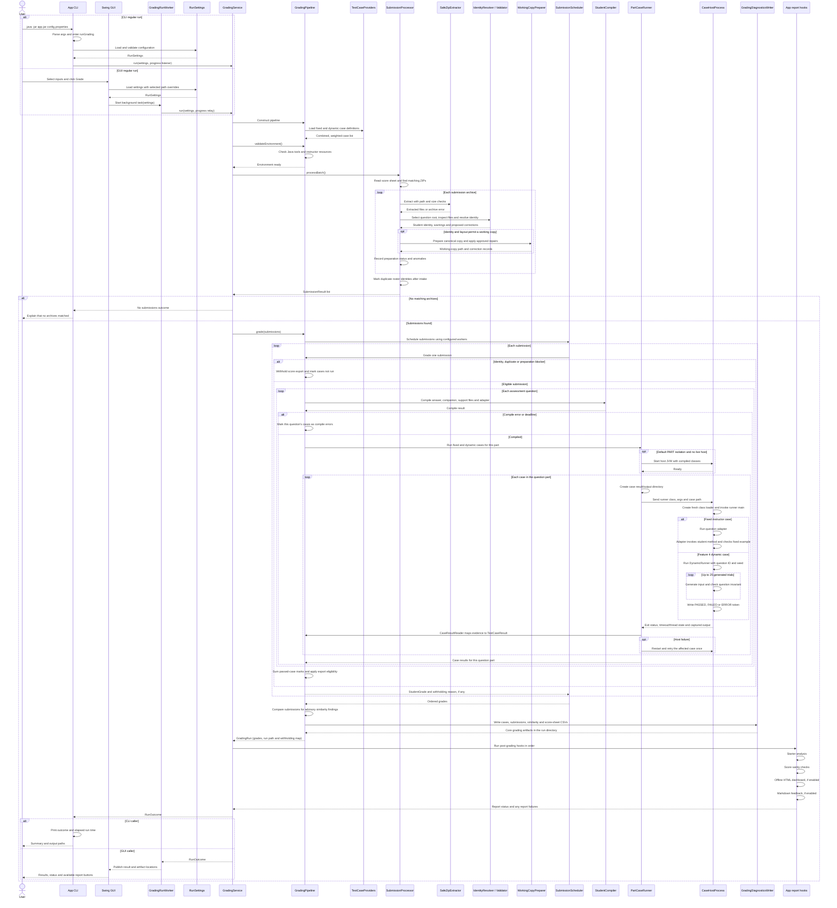
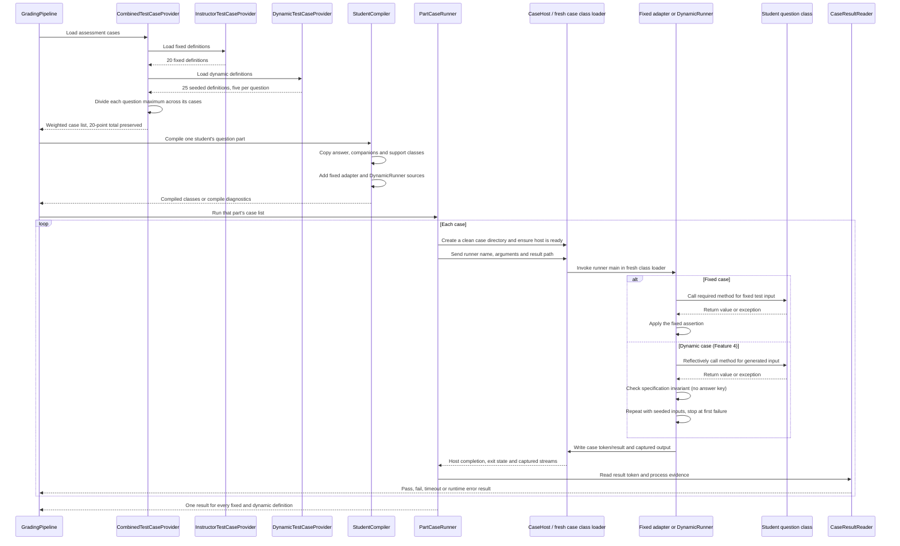
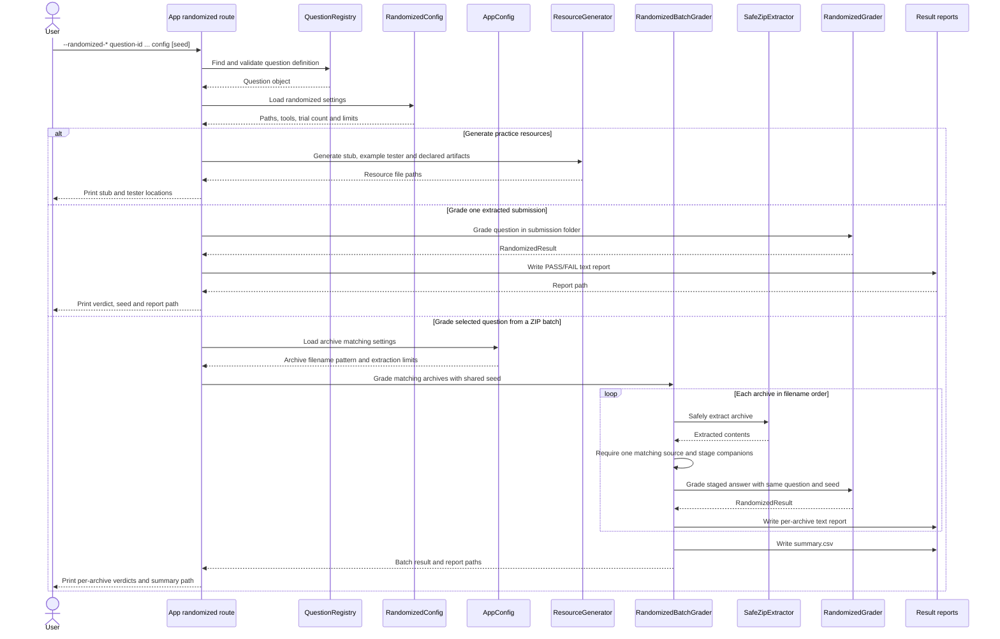
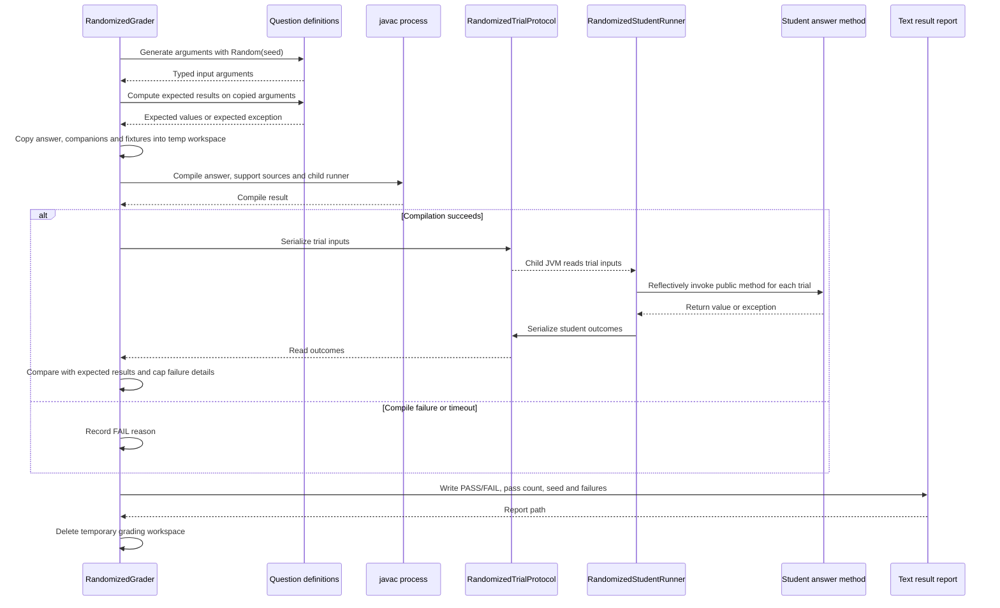

# Application Sequence Diagrams

These diagrams show how a request moves through the current application. The
regular grading path is the default. The optional Question-object mode branches
from `App` and does not enter the regular score pipeline.

## 1. Full regular grading run

The CLI and Swing window use the same `GradingService`. Their setup and final
display differ; the preparation, grading and reporting work is shared.

### Reading the regular path

1. **Configuration and case plan:** `App` loads settings, then `GradingService`
   constructs the pipeline. The pipeline combines fixed instructor cases with
   Feature 4 dynamic cases before checking that Java and the configured
   assessment resources are available.
2. **Preparation:** `SubmissionProcessor` safely extracts each archive,
   identifies its student and layout, records problems, and prepares a
   separate working copy when possible. Duplicate identities are checked
   after the full intake list is known.
3. **Compilation and execution:** `GradingPipeline` schedules submissions.
   Each eligible student's question part is compiled separately. The default
   `PART` mode reuses a host JVM for that part, but gives each case a fresh
   class loader and its own result/output directory. `CASE` mode instead
   starts a JVM per case. Feature 4 is simply another case runner in this
   loop: its generated cases invoke `DynamicRunner`.
4. **Scoring and export:** passed cases earn their configured share of the
   question's maximum. The combined provider keeps the five maxima at 3, 3, 5,
   5 and 4 points (20 total). Blocked submissions keep `NOT_RUN` evidence and
   are withheld from score export.
5. **Reports and presentation:** the pipeline writes the core CSVs first.
   Optional starter analysis, score sanity checks, HTML and Markdown reports
   run afterward in that order. Both the CLI and GUI receive a `RunOutcome`
   from the same service.

When more than one worker is selected, submissions may be graded concurrently
and returned in input order. That does not change the case definitions or
scoring rules. In the default case-host mode, a host-level failure is retried
once on a fresh host; an individual timed-out or abnormal case causes the host
to be replaced before the next case.

## 2. The regular case execution detail

This is the Feature 4 insertion point shown in the first diagram. There are
five dynamic case definitions per question; each definition generates up to
25 internal inputs using its fixed seed. The 25 internal trials determine one
case verdict and one case score.

The default host preserves separation between cases while saving JVM startup
time: `CaseHost` opens a new class loader for each case, captures that case's
standard output/error, and restores process-wide settings afterward. The
parent enforces the case deadline and replaces an abnormal host. This is
process management for grading reliability, not a security sandbox; student
code still runs with the grading account's operating-system permissions.

## 3. Optional Question-object commands

The `--randomized-*` commands are handled directly by `App.runRandomized`.
They do not call `GradingService` or the normal score-sheet pipeline.

## 4. Inside one Question-object grade

Single-submission grading and each archive in a batch use the same
`RandomizedGrader` path.

In this mode, `Question.answerKey` is the trusted oracle and the student
method runs in another JVM. That differs from Feature 4, where `DynamicRunner`
checks rules from the assessment without calculating expected answers. A
completed Question-object FAIL is still a completed command; it remains a
separate report and never changes the regular score sheet.

## Source map

- Entry points and command routing: `src/main/java/autograder/App.java`.
- Shared CLI/GUI orchestration: `src/main/java/autograder/GradingService.java`
  and `src/main/java/autograder/gui/GradingRunWorker.java`.
- Submission preparation: `src/main/java/autograder/submission/SubmissionProcessor.java`.
- Case construction, scheduling, scoring and export:
  `src/main/java/autograder/grading/`.
- Compilation and case hosting: `src/main/java/autograder/execution/`.
- Feature 4 runner: `src/main/resources/autograder/adapters/DynamicRunner.java`.
- Question-object system: `src/main/java/autograder/autotester/` and
  `src/main/resources/autograder/autotester/RandomizedStudentRunner.java`.
