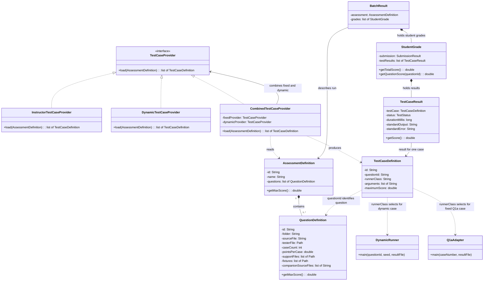
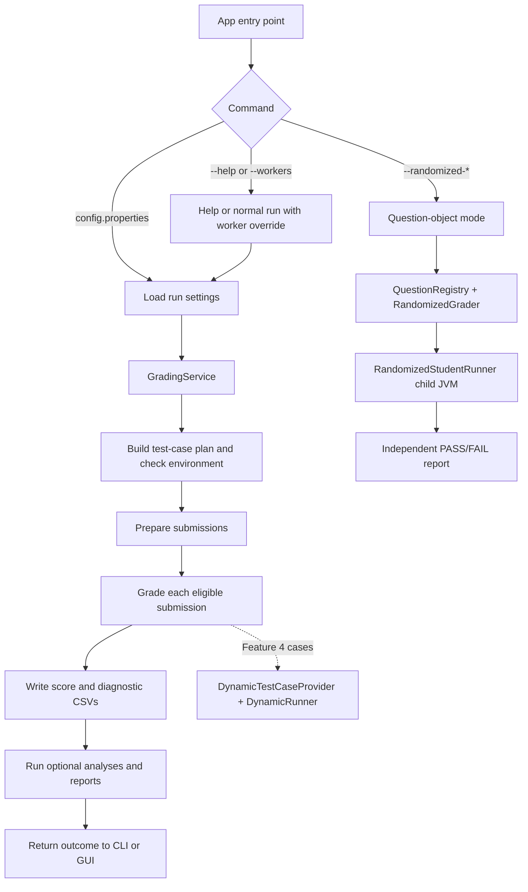

# How the Autograder Works

This guide gives you the run order first, then zooms in on the two pieces you
worked on:

- **Feature 4** adds randomized property checks to the regular scored
  assessment.
- **The Question-object autograder** is an optional, separate mode that
  defines questions as `Question` objects and reports PASS/FAIL against a
  reference implementation.

Both use generated inputs. They enter the application at different points,
use different ways to decide correctness, and have different effects on marks.

## First: what is an assessment question in the regular workflow?

In the normal grading path, a question is a **`QuestionDefinition`**. It is a
data object describing one part of the assessment and the files/rules the
grader needs in order to find and grade that part. It is not the student's
answer, it is not the Java test adapter, and it does not contain the fixed
test inputs or expected answers.

`config.properties` supplies values that `AssessmentConfigLoader` turns into
objects:

| Config setting | Becomes / means |
| --- | --- |
| `assessment.id`, `assessment.name` | The overall assessment's ID and display name in `AssessmentDefinition`. |
| `assessment.question.ids` | The ordered IDs of the question parts, for example `Q1a,Q1b,Q2a,Q2b,Q3`. The loader creates one `QuestionDefinition` for each ID. |
| `assessment.question.Q1a.folder` | Where to look inside a prepared student submission for the answer, e.g. folder `Q1`. |
| `assessment.question.Q1a.source.file` | The student's source filename for that part, e.g. `Q1a.java`. |
| `assessment.question.Q1a.tester.file` | Path to the supplied instructor tester. The current fixed provider checks that this file matches the expected supplied version; the normal grader does not launch this file. |
| `assessment.question.Q1a.case.count`, `points.per.case` | The original fixed case count and points used to establish this question's maximum. Feature 4 later redistributes that maximum across fixed and dynamic case definitions. |
| `support.files`, `fixtures`, `companion.source.files` | Extra compiled classes, runtime data files, and student source files needed to compile/run the part. |

For example, Q1a has `case.count=3` and `points.per.case=1`, so its
`QuestionDefinition` has a maximum of 3 marks. Feature 4's provider uses the
question ID and the assessment order to create dynamic case definitions for
Q1a; the input generator itself lives in `DynamicRunner`, not in this object
or in `config.properties`.

### Normal grading object map



Read the diagram as two halves. The dotted `TestCaseDefinition` to
`QuestionDefinition` association is conceptual: the case holds the question ID
string, not a direct `QuestionDefinition` reference. `AssessmentDefinition`
contains the assessment question metadata. Providers turn that metadata into
`TestCaseDefinition` plans. Later,
the graders run those plans and create `TestCaseResult`s. A `StudentGrade`
collects one student's case results, and `BatchResult` collects the assessment
and students' grades.

### Do not confuse these two classes called Question

The normal workflow's `AssessmentDefinition.getQuestions()` returns
`QuestionDefinition` objects described above. The separate optional randomized
workflow has another class named `autograder.autotester.question.Question`. That
abstract class stores a method signature, typed parameters, generators,
artifacts, comparison options, and an `answerKey` method. It is **not** the
type held by the normal assessment and is not currently wired into the
regular score-sheet pipeline.

## One complete example: grading one student's Q1a

Here is the concrete input-to-output path. The key point is that providers
prepare **instructions for running checks**. They do not execute the student
method. The pipeline and case runner execute those instructions later.

```text
config.properties
    -> AssessmentConfigLoader creates AssessmentDefinition and QuestionDefinitions
    -> fixed provider creates fixed-case instructions
    -> dynamic provider creates dynamic-case instructions
    -> combined provider joins those instruction lists and assigns case marks
    -> GradingPipeline stores the combined list for this run
    -> for each student, pipeline selects the Q1a instructions
    -> StudentCompiler compiles that student's Q1a code and the runner classes
    -> case runner executes each instruction's named runner class
    -> each runner writes a status; CaseResultReader creates TestCaseResult
    -> StudentGrade adds the passing case marks
```

### What each step receives and returns

| Step | Receives | Does | Returns / leaves behind |
| --- | --- | --- | --- |
| Assessment loader | Values such as `assessment.question.ids=Q1a,...`, `Q1a.folder=Q1`, `Q1a.source.file=Q1a.java`, `Q1a.case.count=3`, `Q1a.points.per.case=1` | Converts the properties into Java data objects. | An `AssessmentDefinition`; its `questions` list contains a `QuestionDefinition` for Q1a and each other part. |
| `InstructorTestCaseProvider` | The assessment definition | Checks supported IDs/counts/points and that the configured tester file is the expected supplied version. Creates one fixed plan per fixed case. | For Q1a: three definitions named `Q1a-1`, `Q1a-2`, `Q1a-3`; runner `Q1aAdapter`; arguments `1`, `2`, `3`. It does not execute `Q1aTester.java`. |
| `DynamicTestCaseProvider` | The same assessment definition | Loops over its question definitions and makes five dynamic plans for each. Computes one seed for each question/case pair. | For Q1a: five definitions named `Q1a-dynamic-1` through `Q1a-dynamic-5`; runner `DynamicRunner`; arguments contain `Q1a` and that case's seed. No random word lists have been created yet. |
| `CombinedTestCaseProvider` | The fixed list and the dynamic list (because both providers implement `TestCaseProvider`) plus the assessment definition | Calls each provider's `load(assessment)`, concatenates the two returned lists, groups the cases by question ID, and assigns each case an equal share of its question's max mark. | One combined list. For Q1a it holds 8 definitions whose maximum scores add up to 3. |
| `GradingPipeline` | The combined list, saved in its `cases` field | For each eligible student, selects definitions matching the current question ID. For Q1a, it selects those 8 definitions. | A per-question list of case instructions, passed to compilation and execution. |
| `StudentCompiler` | Q1a's `QuestionDefinition` plus the prepared student's working-copy path | Compiles the student's `Q1a.java` with `Q1aAdapter.java`, `DynamicRunner.java`, and required support/companion files into a clean Q1a workspace. This happens once for Q1a, before its cases run. | Compiled student and harness classes. |
| Case runner | One `TestCaseDefinition` at a time plus the compiled classes | Looks at `runnerClass`, passes the definition's arguments and a result-file path, and runs that named harness. | One harness execution. |
| `CaseResultReader` | Harness process information and its result file | Maps `PASSED`, `FAILED`, and `ERROR` (plus timeout/exit/result-file failures) to the normal status enum. | One `TestCaseResult` linked to that definition. |
| `StudentGrade` | All of this student's `TestCaseResult`s | Adds the points earned by passing cases; non-passing cases earn zero. | This student's total and per-question scores. |

### What “runner class” means

It is the name of the Java harness class that performs one check. It is not
the student's class and it is not another provider. The harness is compiled
beside the student's class so it can call the student's code. The definition
selects which harness should run:

| One Q1a definition | Harness actually run | Meaning of its arguments |
| --- | --- | --- |
| `Q1a-1` | `Q1aAdapter` | `1` means run fixed example 1, whose input and expected result are in the adapter. |
| `Q1a-dynamic-1` | `DynamicRunner` | `Q1a` selects the Q1a trial function; the seed initializes Java's `Random`. The runner then generates the inputs itself. |

In the default `PART` mode, the case runner asks a reusable child host JVM to
run that named class in a fresh class loader for the case. In `CASE` mode it
starts a child JVM for each case. Either way, `runnerClass` is the switch that
selects the harness. Once selected, that harness calls the student's Q1a
method and writes a small status token. For a dynamic case, the runner
internally tries up to 25 word lists but still writes just one final status
for its one definition.

### Does it extract the ZIP for every case, and what is deleted?

No. `SubmissionProcessor` extracts each ZIP once during batch preparation and
creates a prepared working copy once for that submission. The grading cases
use that prepared copy; they do not reopen or re-extract the original ZIP.
`StudentCompiler` copies the selected question source into that run's grading
workspace and compiles it once per question part, before its fixed and dynamic
cases run.

Each case gets its own directory for fixture copies, captured output, and the
small `case-result.txt` status token. The random Q1a word lists are generated
inside `DynamicRunner` memory; they are not written as separate test files.
Before a case runs, `PartCaseRunner` deletes and recreates that case's
directory so stale files cannot affect a rerun. It does not delete the case
directory immediately after that case. The extraction, prepared copy,
grading workspace, and reports are left under the configured run/output
directories so the run can be diagnosed and its evidence inspected.

### What is Feature 4 scope, and what is shared grading infrastructure?

Your feature-specific responsibility is the dynamic test behavior: create
the five seeded `DynamicRunner` definitions for each question, generate the
question-appropriate inputs, check the intended properties, and return a
valid case status. The normal grader supplies the shared machinery around
that behavior: extract and prepare submissions, compile each question part,
execute the runner class with a timeout, capture its output, convert its
status into `TestCaseResult`, apply marks, and write the regular reports.

So the short ownership answer is: **Feature 4 provides dynamic checks; the
main grading pipeline executes and scores them.** You should understand that
connection well enough to explain it, but the generic submission scheduler,
case host, compilation lifecycle, identity decisions, and CSV writing are
shared application responsibilities rather than the random-input algorithm
itself.

### The actual loops and calls in the Java code

Here are the method names behind the previous flow:

1. `GradingService.run` constructs `GradingPipeline`, calls
   `validateEnvironment`, then `SubmissionProcessor.processBatch` prepares
   submissions. If the result list is empty, grading stops there.
2. `GradingService` calls `pipeline.grade(submissions)`.
3. `GradingPipeline.grade` gives `SubmissionScheduler.run` a task for each
   submission. The scheduler loops over submissions (sequentially or with
   worker threads); its task calls `GradingPipeline.gradeSubmission`.
4. `gradeSubmission` checks identity/preparation blockers. If eligible, it
   loops over the assessment's `QuestionDefinition`s and calls
   `gradeQuestion(submission, question, ...)` for each one.
5. `gradeQuestion` selects the saved case definitions with that
   `questionId`, then invokes `StudentCompiler` once for that question part.
   After successful compilation, the default `PART` setting delegates its
   case loop to `PartCaseRunner.run`.
6. **The default test-case `for` loop is in `PartCaseRunner.run`:** for each
   `TestCaseDefinition`, it calls `runWithRetry`, which calls `runCase`.
   `runCase` appends a result-file path to the definition's arguments and
   calls `CaseHostProcess.run(test.getRunnerClass(), caseDirectory, args, ...)`.
7. `CaseHostProcess` sends the runner class, case directory, and arguments to
   the child `CaseHost` JVM. `CaseHost` loads that runner class in a fresh
   class loader and invokes its static `main(String[])`. That is where
   `Q1aAdapter` or `DynamicRunner` actually runs.
8. `CaseResultReader` reads the runner's status token and creates the
   `TestCaseResult`; when the question is finished, `StudentGrade` sums the
   passing case scores.

If configuration uses `execution.case.isolation=CASE` instead of the default
`PART`, the per-case loop is in `GradingPipeline.gradeQuestion` and it invokes
`CaseExecutor` once for each definition. The same runner-class/arguments
selection still applies.

### Why combine the providers?

Without combination, the regular pipeline would need separate fixed-case and
dynamic-case grading paths, separate aggregation, and special report/scoring
handling. Instead, both providers produce the same kind of plan object:
`TestCaseDefinition`. The combined provider makes one list, and the existing
pipeline can use one loop, one result type, and one score calculation for
both kinds. The only per-case difference is which runner class the
definition names.

For the supplied assessment, the combined list has 45 scored definitions per
student: 20 fixed and 25 dynamic. For Q1a, its 3 marks are divided across 8
definitions, so a passing case earns about 0.375. This keeps the Q1a maximum
at 3, but it does mean each fixed case is worth less than its original 1 mark.

## The short version

The regular application prepares a safe working copy of each submission, then
grades its question files, writes the required score sheet and diagnostics,
and finally generates optional reports. Feature 4 plugs into the regular
grading pipeline as another source of scored test cases.

The Question-object mode branches from the command line before regular grading
starts. It picks one registered question, generates reproducible trials,
compiles one answer in a temporary workspace, calls it in a separate JVM, and
writes a separate result. It never adds marks to `scorereport.csv`.

## Overall execution map



## Walkthrough: regular grading

The usual command is:

```text
java -jar target/auto-grading-system-1.0-SNAPSHOT.jar config.properties
```

### 1. `App` selects the route

`autograder.App.main` calls `App.run`. The first argument determines what
happens:

- `--help` prints command usage.
- `--randomized-*` enters the optional Question-object mode described later.
- `--workers <N|auto> config.properties` runs regular grading with a temporary
  worker-count override.
- A single properties-file argument starts regular grading with configured
  settings.

For a regular run, `App.runGrading` loads the settings and starts the terminal
progress/cancellation support. It then calls `GradingService`. The GUI uses
that same service through `GradingRunWorker`, so preparation, grading and
reporting rules are shared between the command line and the window.

### 2. Settings and environment are checked

`RunSettings` reads the properties file once and builds the assessment,
execution, and optional report/analysis configurations. Relative paths are
resolved from the properties file. A `--workers` value replaces the configured
worker count for this run only.

`GradingService` creates the `GradingPipeline`. During construction, the
pipeline asks the fixed and dynamic `TestCaseProvider`s for their definitions
and combines them. Before touching submissions, the service checks that Java,
`javac`, and the configured instructor resources are available. A setup error
is reported as an environment-stage failure.

### 3. Submissions are prepared

`SubmissionProcessor.processBatch` loads the roster/score sheet, checks the
assessment denominator, finds matching ZIP archives and creates separate run
directories for extraction and prepared working copies. For each archive it:

1. Extracts the ZIP with `SafeZipExtractor` limits and path checks.
2. Selects the student's question root and checks expected folders/files.
3. Resolves identity from the archive, roster and source headers, recording
   warnings and proposed corrections.
4. If identity and source layout allow safe preparation, copies the submission
   into a canonical working directory and applies approved repairs there.

The supplied archive remains the evidence; compilation uses the prepared
working copy. Preparation problems stay attached to that student. After the
batch is read, duplicate roster identities are marked so the grader can avoid
exporting an ambiguous mark. If no archives matched, the service returns a
`NO_SUBMISSIONS` outcome and does not proceed to grading.

### 4. The pipeline grades submissions

`GradingPipeline.grade` creates a fresh output directory for this run and
schedules submissions using the configured worker count. Parallelism is at
the **submission** level; the scheduler keeps returned grades in input order.
For each submission, the pipeline first checks whether its identity,
preparation, or duplicate status blocks score export. A blocked submission
still gets `NOT_RUN` case records so the reason is visible in diagnostics.

For an eligible submission, the pipeline processes each assessment question
separately:

1. `StudentCompiler` creates a clean source/classes workspace for this question
   part. It copies the answer and required companions, adds support classes
   and the question's fixed adapter, and compiles with annotation processing
   disabled. Feature 4's `DynamicRunner.java` is also compiled into this
   directory.
2. If compilation fails or times out, the question's cases receive
   `COMPILE_ERROR`; other question parts and submissions can continue.
3. Otherwise, the pipeline runs that question's fixed and dynamic cases and
   records each as passed, failed, timed out, runtime error, or not run.

By default, `execution.case.isolation` is `PART`. `PartCaseRunner` starts one
child JVM for a compiled question part and reuses it across that part's cases.
Each case still gets a fresh class loader, its own output/result directory,
empty standard input, and restored global properties, locale and time zone.
Fixture bytes are checked between cases and reset if student code changed
them. A timeout, crash, nonzero exit or leftover thread causes the host to be
replaced before another case; a host-level failure is retried once in a fresh
host. With `execution.case.isolation=CASE`, the older one-child-JVM-per-case
path is used instead.

This isolation reduces unwanted state leaking between tests and avoids starting
a new JVM for every case in the default mode. It is still not an operating
system security sandbox: student code runs with the grading account's file,
network and process permissions.

### 5. Feature 4 in the normal grading path

Feature 4 has two different moments: first, the Java pipeline **plans** its
dynamic cases; later, while grading one student's question, a runner
**generates and checks** random inputs for each planned case. Keeping those
steps separate helps explain what the provider returns and when random data
actually exists.

#### Quick map: who does what?

```text
AssessmentDefinition
  -> TestCaseProvider makes a list of TestCaseDefinition plans
  -> GradingPipeline groups those plans by question and selects one question
  -> case runner executes the runner named in each plan
  -> DynamicRunner uses the plan's seed to make random trial inputs
  -> trialQ1a selects the Q1a rule and calls the student's method
  -> TestCaseResult records this one case's final status and score
```

These names are different jobs, not different names for the same test:

| Name | Plain meaning | Q1a example |
| --- | --- | --- |
| `TestCaseProvider` | Builds the plan for which scored checks should run. It does not run them or make the random inputs. | `DynamicTestCaseProvider` creates five dynamic plans for Q1a. |
| `TestCaseDefinition` | One plan/card for one scored check: ID, question ID, runner class, runner arguments, and max points. | `Q1a-dynamic-1`, runner `DynamicRunner`, arguments `Q1a` and a seed. |
| Seed | A starting number for Java's pseudo-random generator. It is not the input, an answer, or a hash of the student's work. The same seed and code reproduce the same random choices. | `new Random(seed)` makes the choices of list size and word-bank entries. |
| `DynamicRunner` | The executable test harness for dynamic cases. It reads the question ID and seed, dispatches to that question's trial function, and writes the case's final status. | For question ID `Q1a`, it calls `trialQ1a(random)`. |
| `trialQ1a` | The Q1a-specific recipe for one generated input and the rule used to check the answer. It returns success or a failure explanation. | It creates one word list, calls the student, and checks which words should be returned. |
| `invokeStatic` | A helper using Java reflection to find a named class/method and call it while the grader runs. “Static” means the method is called on the class, without making a `Q1a` object. | It loads student class `Q1a`, finds `getIsogramWords(ArrayList)`, and calls it with the generated list. |
| `TestCaseResult` | The outcome after one runner plan has finished; it is not another plan. | One `PASSED` or `FAILED` result for `Q1a-dynamic-1`, covering up to 25 inner trials. |

Only definitions whose runner class is `DynamicRunner` go through the dynamic
logic. Fixed definitions name `Q1aAdapter` (or the adapter for their question)
and run the fixed checks. Both kinds produce ordinary case results for the
same grading pipeline.

#### 5.1 When Feature 4 is selected

The regular command, for example `run.bat config.properties`, routes through
`App.runGrading`, loads the ordinary `RunSettings`, then calls
`GradingService.run`. Arguments beginning `--randomized-` take a different
route in `App` and do not select this Feature 4 path. The GUI also uses
`GradingService`, so it gets this same regular fixed-plus-dynamic grading
workflow.

When `GradingService` constructs `GradingPipeline`, the pipeline constructor
creates three providers and loads their cases from the already-built
`AssessmentDefinition`:

1. `InstructorTestCaseProvider` validates the supported question IDs, expected
   fixed case counts, configured points, and that each configured tester file
   still matches the supplied original tester content. It creates definitions
   such as `Q1a-1` with runner class `Q1aAdapter` and argument `1`.
2. `DynamicTestCaseProvider` loops over the assessment's five
   `QuestionDefinition`s. For every question it creates five definitions,
   named for example `Q1a-dynamic-1` through `Q1a-dynamic-5`. Each definition
   names `DynamicRunner`, includes the question ID and a seed as arguments,
   and initially carries a points value.
3. `CombinedTestCaseProvider` places both lists together and replaces the
   initial case weights with equal shares of that question's configured
   maximum mark. At this point it has created **case instructions**, not the
   generated strings, numbers, courses, or shapes. Those inputs are made later
   when each case executes.

`TestCaseProvider` is an interface: it is the shared promise that a provider
has a `load(assessment)` operation returning case definitions. The fixed,
dynamic, and combined providers each implement that operation. The combined
provider has references to the fixed and dynamic provider objects; when its
own `load` method runs, it calls `load(assessment)` on each, receives two
lists, concatenates them, and assigns the final case weights. It does not call
the instructor tester or run any student code.

#### 5.1a Who consumes the definitions?

The consumer is `GradingPipeline`. Its constructor calls the combined
provider once and saves the returned definitions in its `cases` list. Later,
for each eligible student and each assessment question, the pipeline filters
that saved list by `questionId`. So for Q1a it selects the three fixed and
five dynamic Q1a definitions; it does the same separately for Q1b, Q2a, Q2b,
and Q3.

The pipeline then compiles that student's source for the question once and
hands the question's definitions to the case runner. The runner loops over
them one at a time. For each definition, it reads `runnerClass` and
`arguments`, invokes that Java runner, reads the result token, and creates one
`TestCaseResult`. The runner class is the **name of the Java harness to
execute**. `Q1aAdapter` is the fixed harness; `DynamicRunner` is the dynamic
harness. They both call the student's compiled method, but they prepare and
check the case differently.

For Q1a, two example plan cards look like this:

| Definition | `runnerClass` | `arguments` before the result-file path is added | What the harness does |
| --- | --- | --- | --- |
| `Q1a-1` | `Q1aAdapter` | `1` | Runs fixed instructor example number 1. |
| `Q1a-dynamic-1` | `DynamicRunner` | `Q1a`, then a seed number | Generates random inputs and checks the Q1a invariant. |

The case harness adds a result-file path when it invokes the runner. In the
default `PART` mode, the cases run through a reusable child host JVM with a
fresh class loader for each case; the harness class named by each definition
is still selected separately. A dynamic plan is still just one plan card: its
25 inner Q1a trials result in one `TestCaseResult` and one allocated score.
Finally, `StudentGrade` adds the scores from all the result objects. A passing
case earns its `maximumScore`; any non-passing status earns zero.

The standard configuration gives Q1a 3 cases at 1 point each, Q1b 3 at 1,
Q2a 5 at 1, Q2b 5 at 1, and Q3 4 at 1. Those define the question maxima
**3, 3, 5, 5, 4** (20 total). The combined provider sees 8 cases for Q1a and
Q1b, 10 for Q2a and Q2b, and 9 for Q3, then spreads each question's maximum
across its own combined cases:

| Question | Fixed cases | Dynamic cases | Cases counted for marks | Max | Approx. marks per case |
| --- | ---: | ---: | ---: | ---: | ---: |
| Q1a | 3 | 5 | 8 | 3 | 0.375 |
| Q1b | 3 | 5 | 8 | 3 | 0.375 |
| Q2a | 5 | 5 | 10 | 5 | 0.5 |
| Q2b | 5 | 5 | 10 | 5 | 0.5 |
| Q3 | 4 | 5 | 9 | 4 | about 0.4444 |
| **Assessment** | **20** | **25** | **45** | **20** | — |

The last case of a question receives any tiny decimal remainder so the case
weights add exactly to the question maximum. Thus the fixed cases are still
graded, but their old per-case value is not retained: the **question total**
is retained and shared with the added dynamic cases.

#### 5.2 From prepared student to DynamicRunner

After the intake workflow has made a usable working copy and identified the
student, `GradingPipeline.grade` schedules that submission. It then visits
each assessment question. If the submission is blocked due to unresolved or
duplicate identity or failed preparation, it does not compile or run Feature
4; its case rows are `NOT_RUN` with the blocking reason.

For an eligible submission and a question such as Q1a, the pipeline:

1. Selects all `TestCaseDefinition`s whose `questionId` is `Q1a`. This list
   contains the three fixed definitions followed by Q1a's five dynamic
   definitions.
2. Calls `StudentCompiler` once for Q1a. It prepares a clean per-question
   source/classes workspace, copies the student's Q1a source and companions,
   copies needed support classes, then compiles the embedded `Q1aAdapter.java`
   and `DynamicRunner.java` with them. The runner is generic across the five
   question IDs and invokes the student's method using reflection.
3. If compilation fails or times out, all eight Q1a cases receive
   `COMPILE_ERROR`; other question parts can still be graded.
4. If compilation succeeds, the default `PART` isolation uses a child host
   JVM for the Q1a part and runs its cases in order. For each case, the host
   receives its configured runner class and arguments. For a dynamic
   definition the arguments are the question ID and seed; the case harness
   appends a result-file path. With `CASE` isolation, a separate child process
   is launched for each case instead.
5. `DynamicRunner.main` creates `new Random(seed)`, dispatches to the
   question-specific trial method, writes one short status token to the case
   result file, and returns. `CaseResultReader` maps `PASSED`, `FAILED`, or
   `ERROR` to the normal test status. The configured case timeout applies to
   the whole DynamicRunner case, including its inner trials.

The dynamic cases are independent scoring rows. Inside one dynamic case,
however, the runner may perform many unscored generated trials. It stops that
case on its first failed trial; only if all trials pass does the case earn its
one allocated share of marks. A failing dynamic case earns zero for that row,
but does not by itself cancel the other cases or question parts.

#### 5.3 Repeatability and trial count

There are five dynamic **case definitions per question**. Their seeds are
calculated in `DynamicTestCaseProvider` using:

```text
0x9E3779B1L + questionIndex * 1_000_003L + caseNumber * 7_919L
```

`questionIndex` is the question's position in the assessment, starting at
zero; `caseNumber` is zero-based from 0 through 4. For Q1a, the first seed is
the base `0x9E3779B1L`; its next four seeds add successive multiples of
`7_919L`. Each case creates a fresh `Random` from its own seed. Therefore a
fully passing run has five separate random sequences for Q1a.

Each DynamicRunner case tries **up to 25 inner trials**. A fully passing
submission can therefore get up to 125 generated inputs for each question
(five cases times 25 trials). Since the runner stops as soon as it finds a
failing input, a failing case can try fewer than 25. These inner trials do
not become separate CSV rows or separate marks: each of the five dynamic
definitions produces one `TestCaseResult`.

The runner constructs `Random` once per dynamic case, then keeps using that
same generator for all of the case's inner trials. Each random call advances
its sequence; it does not restart from the seed for every trial. The same
question/case seed is reused for every student, so students are intended to
receive the same sequence of generated inputs. Inputs are not guaranteed to
be unique: for example, two trials can select the same surname or word. The
`25` is the current hard-coded trial limit in `DynamicRunner`; it is a
coverage-versus-runtime setting, not a special mathematical value, and it is
not exposed as a configuration property. There is no benchmark in the code
that proves 25 is optimal.

#### 5.4 What each question's dynamic trial does

The generators and checks are hand-coded in the embedded resource
`src/main/resources/autograder/adapters/DynamicRunner.java`. The runner uses
the seed to vary inputs, then checks a question-specific invariant. It does
not use the separate `autograder.autotester.question.Question` objects or their
`answerKey` methods.

| Question method | Input given to the student method | What the seed randomizes | What one trial checks |
| --- | --- | --- | --- |
| Q1a `getIsogramWords(ArrayList<String>)` | A list of 2-6 words. | Word-bank selections; for each selected word, whether its first letter is prepended (about one in three chances) to make a repeated-letter word. | The result contains exactly the input isograms, preserving counts. Letter checks ignore case and non-letters; this dynamic check does not enforce output order. |
| Q1b `getSumOfEvenIntegers(ArrayList<Object>)` | A mixed list of 1-10 values: integers, booleans, doubles, and strings. | The list length, each value's type, and each value. Integers are -50 to 49; doubles are from 0 up to but not including 100. | The result is an `Integer` equal to the sum of only even `Integer` elements. |
| Q2a `getAverageAge(String, String)` | Fixture filename `personstester.txt` and one candidate name token. | Which eligible uppercase first/last name token from the fixture is queried; fixed-adapter surnames are excluded. | The result is the average age calculated from fixture rows whose first or last name token matches, within `1e-9`. |
| Q2b `getTopStudent(String, String)` | Fixture filename `studentstester.txt` and one course code. | Which eligible course parsed from the fixture is queried; fixed-adapter courses are excluded. | The `Name-GPA` result identifies the highest-GPA student enrolled in that course, with GPA within `1e-9`. |
| Q3 `sortShapes(List<Shape>)` | A list of 3-6 `Circle` and `Rectangle` objects. | List length, first circle radius, and the type/dimensions of additional shapes. Two equal-area rectangles and an over-limit circle are deliberately included each time. | Shapes over area 1000 are removed; the remaining shapes appear exactly once, in descending area then descending perimeter order. |

The seed does not choose which question function to call; the question ID
does that. The seed controls the values chosen inside that function's
generator. The same seed plus the same code and fixture reproduces the same
pseudorandom choices.

##### Inside `DynamicRunner.main`: arguments to one scored verdict

1. `PartCaseRunner` starts from the two arguments stored in the dynamic
   definition (question ID and seed), adds the path for `case-result.txt`,
   and asks the case host to run the class named `DynamicRunner`.
2. `DynamicRunner.main(String[] args)` receives three strings in this order:
   question ID, seed, result-file path. The question ID chooses which
   question-specific check to use; it is not the dynamic case number. The
   seed is parsed as a `long`. The provider always supplies numeric seeds; a
   text hash fallback exists only for nonnumeric direct input.
3. The runner creates `new Random(seed)`. This is a deterministic
   pseudorandom generator: it is not given a list of inputs. Each call such as
   `random.nextInt(...)` or `random.nextBoolean()` advances its internal
   sequence to choose the next value. Reusing the same seed reproduces those
   choices.
4. The runner starts with status `ERROR`, then calls `runTrial(questionId,
   random)` up to 25 times. `runTrial` is a switch: `Q1a` calls `trialQ1a`,
   `Q1b` calls `trialQ1b`, and so on. All 25 trials in this one case share
   the same `Random` object, so each trial consumes the next values in its
   sequence.
5. A question trial returns `null` if its generated input passes the check,
   or a non-null failure explanation if it fails. The loop stops at the first
   failure. If all 25 return `null`, the scored case status becomes
   `PASSED`; if any trial fails it becomes `FAILED`. An unexpected exception
   in the runner sets it to `ERROR`.
6. `writeResult` writes that single status token to the supplied result-file
   path. The case result reader turns the token into one `TestCaseResult`.
   Thus 25 inner Q1a trials produce one scored case result, not 25 score rows.

For the five Q1a definitions, the runner class and question ID are the same;
each definition has a different seed. So `Q1a-dynamic-1` does **not** mean
“run predefined trial number 1.” It means “run the Q1a dynamic check with
seed 1's sequence.” The actual generated inputs are made only after the
runner starts.

##### Q1a: `getIsogramWords(ArrayList<String>)`

**Input generation:** `randomWordList` chooses a list size from 2 to 6 and
draws words from this fixed bank: `alice`, `ben`, `cathy`, `ellen`, `alan`,
`zoe`, `Elle`, `Daniel`, `Canny`, `test`, `hello`, `world`, `Anna`, `Bob`,
`xYz`, `aa`, `a`, `book`, `deer`, and `moon`. For each selected word, there
is a one-in-three chance of prepending its first character (when its length
is greater than one), deliberately turning it into a non-isogram.

**Student call:** reflection invokes `Q1a.getIsogramWords` with the generated
`ArrayList`.

**Check:** the result must be an `ArrayList`; it cannot contain a value that
was not in the input; and its count for each input word must equal that word's
input count if the word is an isogram, or zero otherwise. The helper
`isIsogram` lowercases the word, ignores characters outside ASCII `a` to `z`,
and rejects repeated letters. The count comparison preserves duplicate
occurrences, but it does not check output order. The fixed Q1a adapter uses
exact list equality, so order is checked there.

**Example only:** for input `[alice, aa, cathy]`, the correct returned values
are `[alice, cathy]`. The actual random generator may produce different words
for each seed.

##### Q1b: `getSumOfEvenIntegers(ArrayList<Object>)`

**Input generation:** `randomMixedList` chooses between 1 and 10 elements.
For each element it randomly chooses one of four kinds: an `Integer` from
`-50` through `49`, a `Boolean`, a `Double` from `0` up to but not including
`100`, or a string such as `string37` (the suffix is from 0 through 99).

**Student call and check:** reflection invokes `Q1b.getSumOfEvenIntegers`.
The result must be an `Integer`. The runner computes the expected total by
summing only values that are actually `Integer`s and even (`number % 2 == 0`).
Negative even integers count; odd integers, booleans, doubles, and strings do
not. The returned value must equal that sum exactly.

##### Q2a: `getAverageAge(String file, String surname)`

**Input/query selection:** the case reads the `personstester.txt` fixture.
It extracts name tokens from fixture rows and builds candidates from uppercase
first or last name tokens, excluding `TAY`, `LEE`, `WONG`, and `ONG`, which
the fixed adapter already probes. It chooses one candidate with the seeded
random generator.

**Student call and check:** reflection calls
`Q2a.getAverageAge("personstester.txt", surname)`. The runner independently
scans the same fixture, parses each age, and calculates the average for rows
whose first **or** last whitespace-separated name token matches the query,
case-insensitively. The result must be a `Double` and within `1e-9` of that
average. If there are no matching rows, the helper's expected average is
`0.0`.

This is computed from the fixture rather than a stored table of expected
answers. The current helper's first-or-last-token matching behavior is what
the code checks; when explaining or changing this question, verify that this
matches the intended exam definition.

##### Q2b: `getTopStudent(String file, String course)`

**Input/query selection:** the case reads the `studentstester.txt` fixture,
extracts course codes, and chooses among courses that are not in the fixed
adapter's set: `SMU101`, `CS101`, `CS102`, and `CS103`.

**Student call and check:** reflection calls
`Q2b.getTopStudent("studentstester.txt", course)`. The runner independently
scans the fixture for students enrolled in the selected course and determines
the highest GPA. The student's answer must be a `String` in `Name-GPA` form;
the runner splits at the last dash, parses the GPA, and checks both the
expected name and GPA (within `1e-9`). The fixture helper keeps the first
student encountered if two students tie at the highest GPA.

##### Q3: `sortShapes(List<Shape>)`

**Input generation:** `randomShapes` creates 3 to 6 shapes. It always includes
a large circle whose radius is randomly chosen from 18 to just under 21, so
its area is above 1000 and it must be filtered out. It also includes 6-by-4
and 8-by-3 rectangles: both have area 24, but their perimeters differ (20
and 22), giving a tie-break check. Remaining shapes are randomly chosen
circles or rectangles with dimensions/radii from 1 up to but not including 21.
The runner constructs `Circle` and `Rectangle` instances reflectively.

**Student call and check:** reflection invokes `Q3.sortShapes` with the list.
The result must be a `List`. The runner calculates areas and perimeters using
the shape objects' `getArea` and `getPerimeter` methods, then checks that:

- no result shape has area greater than 1000;
- the result contains exactly once every input shape with area at most 1000;
- result order is descending by area, then descending by perimeter when
  areas tie (within a small floating-point tolerance).

IDs are read from the shape string representation before `=>` to confirm the
input/result membership. The pre-created large circle makes the cutoff check
exerciseable in every trial; the two equal-area rectangles make the
perimeter tie-break exerciseable in every trial.

#### 5.5 What is and is not executed for fixed cases

The normal grader does **not** launch
`Project/Tester-Files/Q1aTester.java` as a program. The fixed provider checks
that the configured tester file still matches the supplied expected content,
then emits numbered case definitions for the embedded per-question adapter,
such as `Q1aAdapter`. That adapter contains the inputs and expected answers
needed for the individual fixed cases. The dynamic definitions instead name
`DynamicRunner`; they do not call `Q1aAdapter` to generate random inputs.

This keeps the roles distinct:

- `QuestionDefinition` describes an assessment part and its configured files
  and maximum marks.
- `TestCaseDefinition` says which runner to invoke, with which arguments,
  for one scored case.
- `Q1aAdapter` checks a fixed instructor example.
- `DynamicRunner` generates seeded inputs and checks question properties.
- `TestCaseResult` records one runner case's final status, time, output, and
  awarded marks.

Feature 4's checks are only as strong as each coded invariant and its
implementation. It increases test diversity and catches many hard-coded
answers, but it is not a general parser for arbitrary instructor tester files
and it is not the Question-object/answer-key grader described later in this
guide.

### 6. Results and reports are written

After grading, the pipeline runs the plagiarism analysis (advisory only) and
`GradingDiagnosticsWriter` writes the core artifacts into the run directory:

- `cases.csv`: every case status, awarded mark, maximum and captured output.
- `submissions.csv`: export/withholding decision, reason and computed score.
- `similarity.csv`: similarity evidence when the detector finds any pairs.
- `scorereport.csv`: the supplied score-sheet format, updated only for
  eligible submissions.

Then `GradingService` invokes the optional report/analysis hooks in this order:

1. Starter-code analysis.
2. Score sanity checks.
3. Offline HTML dashboard, when enabled.
4. Per-student Markdown feedback, when enabled.

These reports read the completed grading evidence; they do not rerun tests.
An optional report failure is surfaced to the user and affects the run status,
but the already-written score and diagnostic CSVs remain available. The
service returns a `RunOutcome`. The CLI prints the final status and elapsed
time; the GUI displays the outcome and links to the artifacts that were
created.

## Walkthrough: the Question-object mode

This is the separate system where each question is an object. It is selected
by one of these commands:

```text
java -jar target/auto-grading-system-1.0-SNAPSHOT.jar --randomized-resources <question-id> config.properties
java -jar target/auto-grading-system-1.0-SNAPSHOT.jar --randomized-grade <question-id> <submission-folder> config.properties [seed]
java -jar target/auto-grading-system-1.0-SNAPSHOT.jar --randomized-grade-batch <question-id> <zip-folder> config.properties [seed]
```

### What a question object represents

`Question` is the common definition. A concrete class such as `Q1a` or `Q3`
declares the required Java signature, parameters, test-case IDs, generators,
optional fixtures/support sources, and `answerKey`. `QuestionRegistry` builds,
validates and indexes these definitions. The runner uses a question's class
and method metadata; it does not need a separate hard-coded grader for every
question.

The class structure has a practical OOP purpose: the shared `Question` type
holds and validates metadata, while each question subclass supplies its own
answer key. `Generator<T>` lets either a reusable generator such as
`RandomInt` or a question-specific lambda produce a parameter value through
the same interface. `RandomizedGrader` then handles those definitions through
the common `Question` contract.

The `answerKey` is the trusted reference implementation for this mode. This
is an intentional difference from Feature 4: the object-based mode computes
expected values in the host application, while Feature 4 checks invariants
without an answer key.

### One randomized grade

1. `App` finds the question in `QuestionRegistry` and loads
   `RandomizedConfig`.
2. `RandomizedGrader` validates the definition and submission folder, then
   uses one `Random(seed)` to generate the configured number of inputs for
   each declared case. It validates each input and calls `answerKey` on a
   copy to store the expected result.
3. It copies the student's source, companions and declared artifacts into a
   temporary workspace, then invokes `javac --release 17`.
4. It serializes the trials and launches
   `RandomizedStudentRunner` in a separate Java process. That runner reflects
   the student's public method, creates an object for instance methods, calls
   it for each trial and writes the outcomes back.
5. The host compares outputs (or checks a declared expected exception),
   writes PASS/FAIL with the seed and a capped set of failing inputs, and
   removes the temporary workspace.

The optional `--randomized-resources` path uses `ResourceGenerator` to write a
stub, a practice tester with generated examples, and any declared support files.
`--randomized-grade-batch` uses `SafeZipExtractor` to handle each matching ZIP,
stages the selected question source, invokes the same `RandomizedGrader`, and
writes per-archive results plus `summary.csv`. A shared batch seed gives each
submission the same generated trials. Run this command once for each question
you want to grade.

These commands report PASS/FAIL independently. A completed student FAIL is
still a completed grading command; invalid setup or infrastructure errors
return a command error. The reports are outside the normal score-sheet flow.

For the full project run, build and execute the regular path with:

```powershell
.\mvnw.cmd clean verify
java -jar target/auto-grading-system-1.0-SNAPSHOT.jar config.properties
```

The first command compiles the project and runs its checks. The second grades
the configured archive batch; it also runs Feature 4 without a separate CLI
switch.

## How the two randomized paths fit together

| | Feature 4 in regular grading | Question-object mode |
| --- | --- | --- |
| How it is entered | Always included in the normal assessment case list | Explicit `--randomized-*` CLI option |
| Question definition | Existing `AssessmentDefinition` / `QuestionDefinition` | Subclass of `autograder.autotester.question.Question` |
| Correctness check | Specification invariant; no generated expected answer | `Question.answerKey` computes expected value |
| Student execution | Uses regular pipeline's compiled part and `DynamicRunner` case | Temporary workspace and `RandomizedStudentRunner` child JVM |
| Result | Fractional marks inside the existing question maximum | Separate PASS/FAIL report and seed |

The design uses a shared `TestCaseProvider` interface for regular cases and
specialized `Question`/`Generator` contracts for the optional mode. Those
contracts make the grading pipeline extensible while keeping question-specific
input generation and checks out of the central orchestration classes.

## Where to read next

- For the exact Feature 4 invariants, seed formula and runner protocol, see
  [`HOW_THIS_FEAT_4_WORKS.md`](HOW_THIS_FEAT_4_WORKS.md).
- For Question-object signatures, generator rules and all randomized settings,
  see [`RANDOMIZED_AUTOGRADER.md`](../RANDOMIZED_AUTOGRADER.md).
- For setup, sample run commands, outputs and GUI use, see
  [`README.md`](../../README.md).
- For the larger component map and execution boundaries, see
  [`ARCHITECTURE.md`](../ARCHITECTURE.md).

Feature 4 remains **REVIEW** on the project board. The latest repository record
still requires William's human clean-build confirmation before it can move to
DONE. The previous recorded Feature 4 evidence is summarized in
[`DYNAMIC_TEST_FEATURE_SUMMARY.md`](DYNAMIC_TEST_FEATURE_SUMMARY.md).\n
