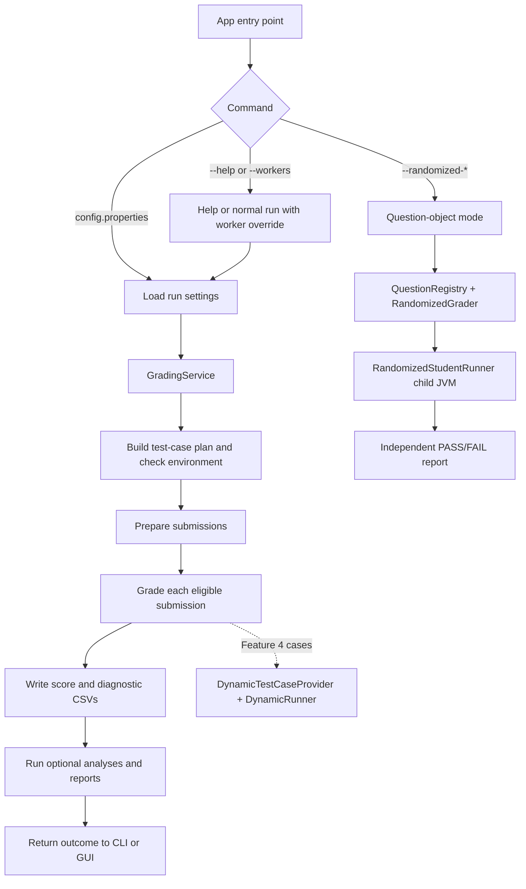

# William's Guide: How the Autograder Works

This guide gives you the run order first, then zooms in on the two pieces you
worked on:

- **Feature 4** adds randomized property checks to the regular scored
  assessment.
- **The Question-object autograder** is an optional, separate mode that
  defines questions as `Question` objects and reports PASS/FAIL against a
  reference implementation.

Both use generated inputs. They enter the application at different points,
use different ways to decide correctness, and have different effects on marks.

## The short version

The regular application prepares a safe working copy of each submission, then
grades its question files, writes the required score sheet and diagnostics,
and finally generates optional reports. Feature 4 plugs into the regular
grading pipeline as another source of scored test cases.

The Question-object mode branches from the command line before regular grading
starts. It picks one registered question, generates reproducible trials,
compiles one answer in a temporary workspace, calls it in a separate JVM, and
writes a separate result. It never adds marks to `scorereport.csv`.

## Overall execution map



## Walkthrough: regular grading

The usual command is:

```text
java -jar target/auto-grading-system-1.0-SNAPSHOT.jar config.properties
```

### 1. `App` selects the route

`autograder.App.main` calls `App.run`. The first argument determines what
happens:

- `--help` prints command usage.
- `--randomized-*` enters the optional Question-object mode described later.
- `--workers <N|auto> config.properties` runs regular grading with a temporary
  worker-count override.
- A single properties-file argument starts regular grading with configured
  settings.

For a regular run, `App.runGrading` loads the settings and starts the terminal
progress/cancellation support. It then calls `GradingService`. The GUI uses
that same service through `GradingRunWorker`, so preparation, grading and
reporting rules are shared between the command line and the window.

### 2. Settings and environment are checked

`RunSettings` reads the properties file once and builds the assessment,
execution, and optional report/analysis configurations. Relative paths are
resolved from the properties file. A `--workers` value replaces the configured
worker count for this run only.

`GradingService` creates the `GradingPipeline`. During construction, the
pipeline asks the fixed and dynamic `TestCaseProvider`s for their definitions
and combines them. Before touching submissions, the service checks that Java,
`javac`, and the configured instructor resources are available. A setup error
is reported as an environment-stage failure.

### 3. Submissions are prepared

`SubmissionProcessor.processBatch` loads the roster/score sheet, checks the
assessment denominator, finds matching ZIP archives and creates separate run
directories for extraction and prepared working copies. For each archive it:

1. Extracts the ZIP with `SafeZipExtractor` limits and path checks.
2. Selects the student's question root and checks expected folders/files.
3. Resolves identity from the archive, roster and source headers, recording
   warnings and proposed corrections.
4. If identity and source layout allow safe preparation, copies the submission
   into a canonical working directory and applies approved repairs there.

The supplied archive remains the evidence; compilation uses the prepared
working copy. Preparation problems stay attached to that student. After the
batch is read, duplicate roster identities are marked so the grader can avoid
exporting an ambiguous mark. If no archives matched, the service returns a
`NO_SUBMISSIONS` outcome and does not proceed to grading.

### 4. The pipeline grades submissions

`GradingPipeline.grade` creates a fresh output directory for this run and
schedules submissions using the configured worker count. Parallelism is at
the **submission** level; the scheduler keeps returned grades in input order.
For each submission, the pipeline first checks whether its identity,
preparation, or duplicate status blocks score export. A blocked submission
still gets `NOT_RUN` case records so the reason is visible in diagnostics.

For an eligible submission, the pipeline processes each assessment question
separately:

1. `StudentCompiler` creates a clean source/classes workspace for this question
   part. It copies the answer and required companions, adds support classes
   and the question's fixed adapter, and compiles with annotation processing
   disabled. Feature 4's `DynamicRunner.java` is also compiled into this
   directory.
2. If compilation fails or times out, the question's cases receive
   `COMPILE_ERROR`; other question parts and submissions can continue.
3. Otherwise, the pipeline runs that question's fixed and dynamic cases and
   records each as passed, failed, timed out, runtime error, or not run.

By default, `execution.case.isolation` is `PART`. `PartCaseRunner` starts one
child JVM for a compiled question part and reuses it across that part's cases.
Each case still gets a fresh class loader, its own output/result directory,
empty standard input, and restored global properties, locale and time zone.
Fixture bytes are checked between cases and reset if student code changed
them. A timeout, crash, nonzero exit or leftover thread causes the host to be
replaced before another case; a host-level failure is retried once in a fresh
host. With `execution.case.isolation=CASE`, the older one-child-JVM-per-case
path is used instead.

This isolation reduces unwanted state leaking between tests and avoids starting
a new JVM for every case in the default mode. It is still not an operating
system security sandbox: student code runs with the grading account's file,
network and process permissions.

### 5. Feature 4 fits into that case loop

`InstructorTestCaseProvider` supplies the 20 fixed cases from the instructor
test definitions. `DynamicTestCaseProvider` adds five named cases per
question. Each case names `DynamicRunner` and carries a deterministic seed.
`CombinedTestCaseProvider` merges both lists and divides each question's
existing maximum across all of its cases. The assessment maxima remain **3,
3, 5, 5 and 4 points** (20 total).

For one dynamic case, `DynamicRunner` uses its seed to generate 25 inputs and
checks an invariant from the question specification. It does not calculate
expected answers. For example, Q1a checks that the returned list contains
exactly the input isograms, preserving duplicates; Q3 checks the area cutoff
and both sort keys. One violated invariant fails that case. A passing case
earns its allocated fraction of the question's marks.

The normal assessment therefore has **45 cases per submission**: 20 fixed and
25 dynamic. The 25 trials inside one dynamic case are a single case verdict,
not 25 separately scored results. Reusing the deterministic seeds means a
rerun uses the same dynamic inputs for the same question/case.

The provider derives a seed for each question/case pair with
`0x9E3779B1L + questionIndex * 1_000_003L + caseNumber * 7_919L`. That makes
each generated case reproducible without using the student's name or answer
to choose its input. The runner checks these rules:

| Question | What the dynamic runner verifies |
| --- | --- |
| Q1a | The result contains exactly the input isograms, with duplicates preserved; letter checks ignore case and non-letters. |
| Q1b | Only even `Integer` elements contribute to the sum; other types are ignored. |
| Q2a | The average matches people whose surname is the first or last name token; candidates avoid the fixed adapter's surname set. |
| Q2b | The returned student is enrolled in the probed course, has the reported GPA, and no enrolled student has a higher GPA; probed courses avoid the fixed set. |
| Q3 | All shapes with area above 1000 are omitted; the rest appear exactly once in descending area/perimeter order. Inputs force both an over-limit shape and an area tie. |

This is how a dynamic case can test new values without becoming an answer key:
the generated values vary, but the rule comes from the assessment statement.
The check is only as good as the invariant and its implementation in
`DynamicRunner`, so it is important to keep the rule aligned with the exam.

### 6. Results and reports are written

After grading, the pipeline runs the plagiarism analysis (advisory only) and
`GradingDiagnosticsWriter` writes the core artifacts into the run directory:

- `cases.csv`: every case status, awarded mark, maximum and captured output.
- `submissions.csv`: export/withholding decision, reason and computed score.
- `similarity.csv`: similarity evidence when the detector finds any pairs.
- `scorereport.csv`: the supplied score-sheet format, updated only for
  eligible submissions.

Then `GradingService` invokes the optional report/analysis hooks in this order:

1. Starter-code analysis.
2. Score sanity checks.
3. Offline HTML dashboard, when enabled.
4. Per-student Markdown feedback, when enabled.

These reports read the completed grading evidence; they do not rerun tests.
An optional report failure is surfaced to the user and affects the run status,
but the already-written score and diagnostic CSVs remain available. The
service returns a `RunOutcome`. The CLI prints the final status and elapsed
time; the GUI displays the outcome and links to the artifacts that were
created.

## Walkthrough: the Question-object mode

This is the separate system where each question is an object. It is selected
by one of these commands:

```text
java -jar target/auto-grading-system-1.0-SNAPSHOT.jar --randomized-resources <question-id> config.properties
java -jar target/auto-grading-system-1.0-SNAPSHOT.jar --randomized-grade <question-id> <submission-folder> config.properties [seed]
java -jar target/auto-grading-system-1.0-SNAPSHOT.jar --randomized-grade-batch <question-id> <zip-folder> config.properties [seed]
```

### What a question object represents

`Question` is the common definition. A concrete class such as `Q1a` or `Q3`
declares the required Java signature, parameters, test-case IDs, generators,
optional fixtures/support sources, and `answerKey`. `QuestionRegistry` builds,
validates and indexes these definitions. The runner uses a question's class
and method metadata; it does not need a separate hard-coded grader for every
question.

The class structure has a practical OOP purpose: the shared `Question` type
holds and validates metadata, while each question subclass supplies its own
answer key. `Generator<T>` lets either a reusable generator such as
`RandomInt` or a question-specific lambda produce a parameter value through
the same interface. `RandomizedGrader` then handles those definitions through
the common `Question` contract.

The `answerKey` is the trusted reference implementation for this mode. This
is an intentional difference from Feature 4: the object-based mode computes
expected values in the host application, while Feature 4 checks invariants
without an answer key.

### One randomized grade

1. `App` finds the question in `QuestionRegistry` and loads
   `RandomizedConfig`.
2. `RandomizedGrader` validates the definition and submission folder, then
   uses one `Random(seed)` to generate the configured number of inputs for
   each declared case. It validates each input and calls `answerKey` on a
   copy to store the expected result.
3. It copies the student's source, companions and declared artifacts into a
   temporary workspace, then invokes `javac --release 17`.
4. It serializes the trials and launches
   `RandomizedStudentRunner` in a separate Java process. That runner reflects
   the student's public method, creates an object for instance methods, calls
   it for each trial and writes the outcomes back.
5. The host compares outputs (or checks a declared expected exception),
   writes PASS/FAIL with the seed and a capped set of failing inputs, and
   removes the temporary workspace.

The optional `--randomized-resources` path uses `ResourceGenerator` to write a
stub, a practice tester with generated examples, and any declared support files.
`--randomized-grade-batch` uses `SafeZipExtractor` to handle each matching ZIP,
stages the selected question source, invokes the same `RandomizedGrader`, and
writes per-archive results plus `summary.csv`. A shared batch seed gives each
submission the same generated trials. Run this command once for each question
you want to grade.

These commands report PASS/FAIL independently. A completed student FAIL is
still a completed grading command; invalid setup or infrastructure errors
return a command error. The reports are outside the normal score-sheet flow.

For the full project run, build and execute the regular path with:

```powershell
.\mvnw.cmd clean verify
java -jar target/auto-grading-system-1.0-SNAPSHOT.jar config.properties
```

The first command compiles the project and runs its checks. The second grades
the configured archive batch; it also runs Feature 4 without a separate CLI
switch.

## How the two randomized paths fit together

| | Feature 4 in regular grading | Question-object mode |
| --- | --- | --- |
| How it is entered | Always included in the normal assessment case list | Explicit `--randomized-*` CLI option |
| Question definition | Existing `AssessmentDefinition` / `QuestionDefinition` | Subclass of `autograder.autotester.Question` |
| Correctness check | Specification invariant; no generated expected answer | `Question.answerKey` computes expected value |
| Student execution | Uses regular pipeline's compiled part and `DynamicRunner` case | Temporary workspace and `RandomizedStudentRunner` child JVM |
| Result | Fractional marks inside the existing question maximum | Separate PASS/FAIL report and seed |

The design uses a shared `TestCaseProvider` interface for regular cases and
specialized `Question`/`Generator` contracts for the optional mode. Those
contracts make the grading pipeline extensible while keeping question-specific
input generation and checks out of the central orchestration classes.

## Where to read next

- For the exact Feature 4 invariants, seed formula and runner protocol, see
  [`docs/f4/HOW_THIS_FEAT_4_WORKS.md`](docs/f4/HOW_THIS_FEAT_4_WORKS.md).
- For Question-object signatures, generator rules and all randomized settings,
  see [`docs/f4/RANDOMIZED_AUTOGRADER.md`](docs/f4/RANDOMIZED_AUTOGRADER.md).
- For setup, sample run commands, outputs and GUI use, see
  [`README.md`](README.md).
- For the larger component map and execution boundaries, see
  [`docs/ARCHITECTURE.md`](docs/ARCHITECTURE.md).

Feature 4 remains **REVIEW** on the project board. The latest repository record
still requires William's human clean-build confirmation before it can move to
DONE. The previous recorded Feature 4 evidence is summarized in
[`docs/f4/DYNAMIC_TEST_FEATURE_SUMMARY.md`](docs/f4/DYNAMIC_TEST_FEATURE_SUMMARY.md).
